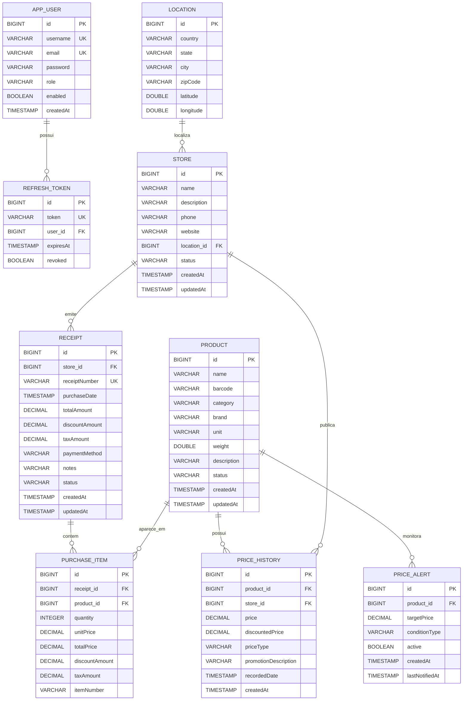

# Modelo de dados do Pretium

Este documento representa o modelo de persistência encontrado no projeto em `src/main/java/org/example/entity`.

## Diagrama entidade-relacionamento



## Entidades e tabelas

### `app_users`

Usuários persistidos para autenticação.

| Campo | Tipo | Regra |
|---|---|---|
| `id` | BIGINT | Chave primária, gerada automaticamente |
| `username` | VARCHAR(80) | Obrigatório e único |
| `email` | VARCHAR(160) | Obrigatório e único |
| `password` | VARCHAR(100) | Obrigatório; deve armazenar senha criptografada |
| `role` | VARCHAR(30) | Obrigatório; padrão `USER` |
| `enabled` | BOOLEAN | Obrigatório; indica se o usuário está ativo |
| `createdAt` | TIMESTAMP | Preenchido na criação |

### `refresh_tokens`

Tokens persistentes usados para renovar sessões JWT.

| Campo | Tipo | Regra |
|---|---|---|
| `id` | BIGINT | Chave primária |
| `token` | VARCHAR(120) | Obrigatório e único |
| `user_id` | BIGINT | FK para `app_users.id` |
| `expiresAt` | TIMESTAMP | Data de expiração |
| `revoked` | BOOLEAN | Indica revogação |

Índice existente: `idx_refresh_tokens_token`.

### `locations`

Localização geográfica de uma ou mais lojas.

| Campo | Tipo | Regra |
|---|---|---|
| `id` | BIGINT | Chave primária |
| `country` | VARCHAR | Obrigatório |
| `state` | VARCHAR | Obrigatório |
| `city` | VARCHAR | Obrigatório |
| `zipCode` | VARCHAR | Opcional |
| `latitude` | DOUBLE | Coordenada geográfica |
| `longitude` | DOUBLE | Coordenada geográfica |

Relacionamento: uma localização pode possuir várias lojas.

### `stores`

Supermercados onde preços são observados e compras são realizadas.

| Campo | Tipo | Regra |
|---|---|---|
| `id` | BIGINT | Chave primária |
| `name` | VARCHAR(150) | Obrigatório |
| `description` | VARCHAR(500) | Opcional |
| `phone` | VARCHAR(20) | Opcional |
| `website` | VARCHAR(150) | Opcional |
| `location_id` | BIGINT | FK para `locations.id` |
| `status` | VARCHAR(50) | `ACTIVE`, `INACTIVE` ou `CLOSED` |
| `createdAt` | TIMESTAMP | Data de criação |
| `updatedAt` | TIMESTAMP | Data de atualização |

### `products`

Catálogo de produtos monitorados.

| Campo | Tipo | Regra |
|---|---|---|
| `id` | BIGINT | Chave primária |
| `name` | VARCHAR(255) | Obrigatório |
| `barcode` | VARCHAR(50) | Opcional |
| `category` | VARCHAR(100) | Opcional |
| `brand` | VARCHAR(50) | Opcional |
| `unit` | VARCHAR(20) | Exemplos: `KG`, `L`, `UN` |
| `weight` | DOUBLE | Peso ou volume |
| `description` | VARCHAR(500) | Opcional |
| `status` | VARCHAR(50) | `ACTIVE`, `INACTIVE` ou `DISCONTINUED` |
| `createdAt` | TIMESTAMP | Data de criação |
| `updatedAt` | TIMESTAMP | Data de atualização |

O preço não é armazenado diretamente em `products`, pois varia por loja, promoção e data.

### `price_history`

Histórico de preços de produtos em lojas.

| Campo | Tipo | Regra |
|---|---|---|
| `id` | BIGINT | Chave primária |
| `product_id` | BIGINT | FK para `products.id` |
| `store_id` | BIGINT | FK para `stores.id` |
| `price` | DECIMAL(10,2) | Preço regular |
| `discountedPrice` | DECIMAL(10,2) | Preço promocional |
| `priceType` | VARCHAR(50) | `REGULAR`, `PROMOTION` ou `SALE` |
| `promotionDescription` | VARCHAR(500) | Detalhes da promoção |
| `recordedDate` | TIMESTAMP | Momento da observação |
| `createdAt` | TIMESTAMP | Data de criação |

### `price_alerts`

Alertas associados a produtos e preços-alvo.

| Campo | Tipo | Regra |
|---|---|---|
| `id` | BIGINT | Chave primária |
| `product_id` | BIGINT | FK para `products.id` |
| `targetPrice` | DECIMAL(10,2) | Preço de referência |
| `conditionType` | VARCHAR(20) | Normalmente `BELOW`; pode ser `ABOVE` ou `EQUAL` |
| `active` | BOOLEAN | Indica se o alerta está ativo |
| `createdAt` | TIMESTAMP | Data de criação |
| `lastNotifiedAt` | TIMESTAMP | Última notificação registrada |

### `receipts`

Cupons ou registros de compras realizados em lojas.

| Campo | Tipo | Regra |
|---|---|---|
| `id` | BIGINT | Chave primária |
| `store_id` | BIGINT | FK para `stores.id` |
| `receiptNumber` | VARCHAR(50) | Obrigatório e único |
| `purchaseDate` | TIMESTAMP | Data e hora da compra |
| `totalAmount` | DECIMAL(10,2) | Total da compra |
| `discountAmount` | DECIMAL(10,2) | Desconto total |
| `taxAmount` | DECIMAL(10,2) | Impostos |
| `paymentMethod` | VARCHAR(100) | Forma de pagamento |
| `notes` | VARCHAR(500) | Observações |
| `status` | VARCHAR(50) | `ACTIVE`, `CANCELLED` ou `ARCHIVED` |
| `createdAt` | TIMESTAMP | Data de criação |
| `updatedAt` | TIMESTAMP | Data de atualização |

### `purchase_items`

Produtos individuais dentro de um cupom.

| Campo | Tipo | Regra |
|---|---|---|
| `id` | BIGINT | Chave primária |
| `receipt_id` | BIGINT | FK para `receipts.id` |
| `product_id` | BIGINT | FK para `products.id` |
| `quantity` | INTEGER | Quantidade comprada |
| `unitPrice` | DECIMAL(10,2) | Preço unitário |
| `totalPrice` | DECIMAL(10,2) | Quantidade multiplicada pelo preço unitário |
| `discountAmount` | DECIMAL(10,2) | Desconto do item |
| `taxAmount` | DECIMAL(10,2) | Imposto do item |
| `itemNumber` | VARCHAR(20) | Número do item no cupom |

## Fluxos principais

### Cadastro de produto

```text
Usuário
  -> Product
      -> nome, marca, categoria, unidade, peso e código de barras
```

### Registro de compra

```text
Store
  -> Receipt
      -> PurchaseItem
          -> Product
          -> quantity
          -> unitPrice
          -> totalPrice
```

### Histórico de preço

```text
Product + Store
  -> PriceHistory
      -> price
      -> discountedPrice
      -> priceType
      -> recordedDate
```

### Alerta de preço

```text
Product
  -> PriceAlert
      -> targetPrice
      -> conditionType
      -> active
```

## Regras de integridade

- `Product.name` é obrigatório.
- `Store.name` é obrigatório.
- `Location.country`, `state` e `city` são obrigatórios.
- `Receipt.receiptNumber` deve ser único.
- `Receipt.store` é obrigatório.
- `Receipt.purchaseDate` é obrigatório.
- `PurchaseItem.receipt` e `PurchaseItem.product` são obrigatórios.
- `PurchaseItem.quantity`, `unitPrice` e `totalPrice` são obrigatórios.
- `PriceHistory.product`, `store` e `price` são obrigatórios.
- `PriceAlert.product` e `targetPrice` são obrigatórios.
- `RefreshToken.token` deve ser único.
- Senhas em `app_users.password` devem ser armazenadas com hash BCrypt, nunca em texto puro.

## Observação sobre o banco atual

O ambiente padrão usa H2 em memória com `ddl-auto: create-drop`. Portanto, os dados são apagados quando a aplicação é encerrada.

Para produção, recomenda-se:

1. utilizar PostgreSQL;
2. alterar `ddl-auto` para `validate`;
3. usar migrations com Flyway ou Liquibase;
4. criar índices para consultas por produto, loja e datas;
5. adicionar auditoria e controle de concorrência quando necessário.

## Status de implementação

- As entidades de catálogo, lojas, compras, preços e alertas já existem no código.
- As entidades `AppUser` e `RefreshToken` já foram criadas para a autenticação JWT.
- A configuração completa de login, emissão de JWT, filtro de segurança e refresh token ainda deve ser concluída antes de ativar o perfil `security` em produção.

